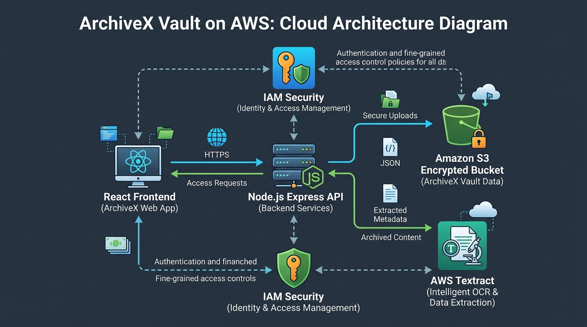
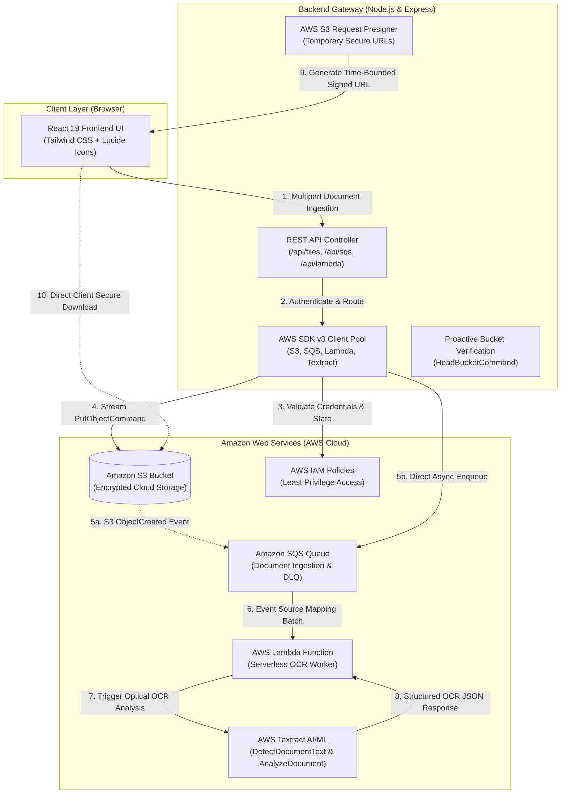

# 🏛️ ArchiveX Vault — Document Intelligence & Cloud Storage System

[](https://aws.amazon.com/s3/)
[](https://aws.amazon.com/lambda/)
[](https://aws.amazon.com/sqs/)
[](https://aws.amazon.com/textract/)
[](https://www.terraform.io/)
[](https://aws.amazon.com/sdk-for-javascript/)
[](https://nodejs.org/)
[](https://expressjs.com/)
[](https://react.dev/)
[](https://www.typescriptlang.org/)

**ArchiveX Vault** is an enterprise-grade cloud-native document intelligence and storage platform. Built with **Node.js, Express, React, and AWS Cloud Services**, it automates secure file lifecycle management on **Amazon S3**, decouples ingestion with **Amazon SQS**, executes asynchronous serverless OCR via **AWS Lambda**, and extracts structured document data using **AWS Textract**.

---

## 📌 What ArchiveX Does

1. **Intelligent Document Ingestion:**
   Upload invoices, receipts, contracts, PDFs, and high-resolution images with real-time MIME-type validation and client-side sanitization.
2. **Decoupled Event-Driven Pipeline (SQS + Lambda):**
   Incoming documents are enqueued into an **Amazon SQS** ingestion queue with a Dead Letter Queue (DLQ) fallback. An **AWS Lambda** serverless worker processes messages concurrently, preventing system bottlenecks during traffic bursts.
3. **Automated AI/ML Text Extraction:**
   Integrates directly with **AWS Textract** (`DetectDocumentTextCommand` & `AnalyzeDocumentCommand`) to extract raw text, key-value pairs, tables, and document metadata on upload.
4. **Secure Cloud Archiving:**
   Stores all binary objects in **Amazon S3** with **AES-256 Server-Side Encryption (SSE-S3)**, strict bucket-owner enforcement, and zero public access.
5. **Time-Bounded Presigned URLs:**
   Uses `@aws-sdk/s3-request-presigner` to issue temporary cryptographic download links (expiring after 15 minutes), offloading heavy media streaming from the application server.
6. **Instant In-Memory Keyword Search:**
   Indexes document content in real-time for millisecond-level full-text retrieval across thousands of pages.

---

## 📐 Cloud System Architecture

### Visual Diagram


### Architecture Data Flow (Mermaid)



---

## 🏗️ Infrastructure as Code (Terraform)

All AWS cloud infrastructure for this project is codified using **Terraform** in the `/terraform` directory:

* `terraform/main.tf` — Provisions Amazon S3 bucket, server-side encryption, CORS, lifecycle tiering, IAM user, and least-privilege policies.
* `terraform/lambda_sqs.tf` — Provisions Amazon SQS Queue, Dead Letter Queue (DLQ), Lambda execution role, CloudWatch logging permissions, and Lambda Event Source Mapping.
* `terraform/variables.tf` — Configurable regions, bucket names, and CORS origins.
* `terraform/outputs.tf` — Exports bucket names, SQS queue URLs, Lambda function ARNs, and API credentials for `.env`.
* `terraform/terraform.tfvars.example` — Template for custom deployments.
* `lambda/ocr-processor/index.mjs` — Serverless Node.js 20.x Lambda function handler packaged and deployed by Terraform.

---

## 🚀 How to Deploy ArchiveX

### Option A: Local / Development Deployment

#### 1. Clone & Install
```bash
git clone https://github.com/Raji-codes/ArchiveX-Vault.git
cd ArchiveX-Vault
npm install
```

#### 2. Provision AWS Cloud Resources with Terraform
```bash
cd terraform
terraform init
terraform plan
terraform apply -auto-approve
```
*Terraform will output your `s3_bucket_name`, `sqs_queue_url`, `lambda_function_arn`, and `iam_access_key_id`.*

#### 3. Configure `.env`
In the project root, create a `.env` file using the Terraform outputs:
```env
PORT=3000
AWS_REGION=ap-southeast-2
AWS_ACCESS_KEY_ID=your_iam_access_key_id
AWS_SECRET_ACCESS_KEY=your_iam_secret_access_key
AWS_S3_BUCKET=your_s3_bucket_name
AWS_SQS_QUEUE_URL=your_sqs_queue_url
AWS_LAMBDA_FUNCTION_NAME=archivex-ocr-processor
```

#### 4. Run Dev Server
```bash
npm run dev
```
Open [http://localhost:3000](http://localhost:3000) in your browser.

---

### Option B: Production Cloud Hosting on AWS (AWS App Runner)

Deploy ArchiveX using **AWS App Runner** (fully managed container service with automatic HTTPS and zero virtual machine maintenance):

1. **Connect Repository:** Link your GitHub repository (`ArchiveX-Vault`) in the AWS App Runner console.
2. **Build Configuration:**
   * **Runtime:** Node.js 18+
   * **Build command:** `npm install && npm run build`
   * **Start command:** `npm start`
   * **Port:** `3000`
3. **Environment Variables:**
   * Configure `AWS_REGION`, `AWS_ACCESS_KEY_ID`, `AWS_SECRET_ACCESS_KEY`, `AWS_S3_BUCKET`, and `AWS_SQS_QUEUE_URL` securely in the App Runner console configuration.

---

## 💰 AWS Cost & Free Tier Breakdown

ArchiveX Vault was specifically engineered to run **completely within the AWS Free Tier ($0/month)** during prototyping and evaluation:

| AWS Service | Free Tier Allowance | ArchiveX Vault Usage | Estimated Cost |
| :--- | :--- | :--- | :--- |
| **Amazon S3** | **5 GB** Standard Storage<br/>20,000 GET / 2,000 PUT requests/mo | Stores documents & archives | **$0.00 / month** |
| **AWS Lambda** | **1,000,000 free requests / month**<br/>3.2 million seconds of compute time | Serverless background OCR processing | **$0.00 / month** |
| **Amazon SQS** | **1,000,000 free requests / month** | Decoupled document ingestion queue | **$0.00 / month** |
| **AWS Textract** | **1,000 pages / month** for 3 months | Document text & table extraction | **$0.00 / month** |
| **Data Transfer** | **100 GB** free egress per month | Presigned URL downloads & API calls | **$0.00 / month** |

### 📉 Cost Optimization Engineering Decisions
1. **S3 Lifecycle Tiering:** Files automatically transition to **S3 Standard-IA (Infrequent Access)** after 30 days and **S3 Glacier** after 90 days, cutting storage costs by up to **80%**.
2. **Event-Driven Decoupling (SQS + Lambda):** Serverless Lambda scales strictly to zero when idle—zero compute charges when no documents are uploaded.
3. **SQS Long Polling:** `receive_wait_time_seconds = 20` eliminates empty reads, keeping requests well within the 1,000,000 free tier limit.
4. **Presigned URL Offloading:** Streaming multi-megabyte files directly between the browser and S3 avoids doubling network egress and reduces server CPU/RAM consumption.
5. **Incomplete Multipart Abort:** Terraform rules automatically purge abandoned chunked uploads after 7 days, preventing orphan storage charges.

---

## 🔒 Security Best Practices Implemented
* **Zero Secret Exposure:** Credentials are never bundled in client code; requests are mediated by server-side AWS SDK v3.
* **IAM Least Privilege:** Dedicated IAM policies grant only minimal required permissions for S3, SQS, Lambda, and Textract.
* **Dead Letter Queue (DLQ):** Failed document parsing jobs are automatically isolated in an SQS DLQ for inspection without data loss.
* **S3 Block Public Access:** All four AWS public access blocks are strictly enabled on the bucket.
* **SSE-S3 AES-256 Encryption:** Objects are encrypted at rest with AWS-managed keys.
